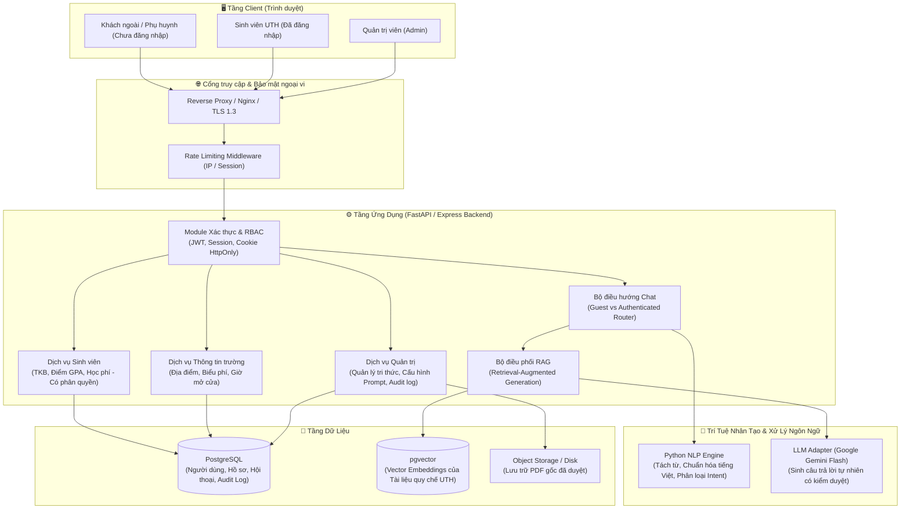
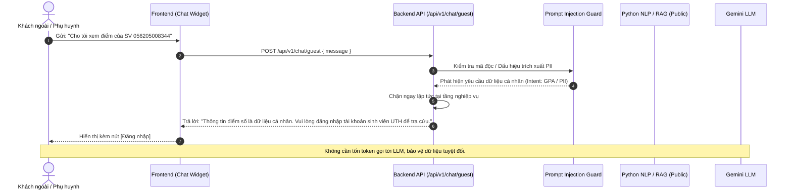
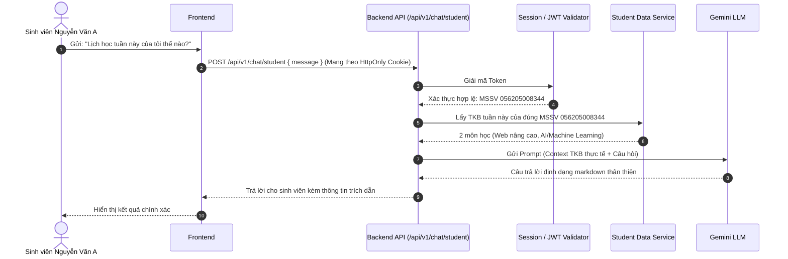

# 🏛️ KIẾN TRÚC HỆ THỐNG (ARCHITECTURE)
**Dự án Cổng Sinh Viên & Trợ Lý Ảo UTH**

---

## 1. Tổng quan kiến trúc cấp cao (High-Level Architecture)

Hệ thống được xây dựng theo mô hình **Modular Monolith** nhằm cân bằng giữa tính đơn giản khi triển khai, hiệu năng và dễ chia việc cho nhóm phát triển.

---

## 2. Mô hình Hybrid AI (Python NLP + LLM)

Để tránh hiện tượng ảo giác (hallucination) của mô hình AI đối với các quy chế mang tính pháp lý của nhà trường, hệ thống sử dụng kiến trúc kết hợp:

1. **Lớp 1: Python NLP Engine (`python_bot_engine.py`)**
   - Loại bỏ dấu tiếng Việt để đối sánh mềm (`remove_accents`).
   - Phân loại ý định (`classify_intent`): `SCHEDULE`, `GPA`, `TUITION`, `REGISTRATION`, `CAMPUS`, `GRADUATION`, `IDENTITY`, `GENERAL`.
   - Tìm kiếm đối sánh từ khóa và n-gram trong tập tri thức kiểm duyệt (`knowledge_base`).
   - Đảm bảo trích xuất đúng ngữ cảnh chính xác 100%.

2. **Lớp 2: LLM Generation (Google Gemini 3.8 Flash)**
   - Không để LLM tự do bịa thông tin.
   - LLM nhận:
     - `System Instruction` đã được làm cứng (Hardened System Prompt).
     - `Context`: Dữ liệu trích xuất từ tài liệu của trường do RAG hoặc Python NLP tìm ra.
     - `User Question`: Câu hỏi của người dùng.
   - Nhiệm vụ của LLM chỉ là: Diễn đạt lại thông tin một cách tự nhiên, lịch sự, chuẩn mực tiếng Việt và trích dẫn nguồn.

---

## 3. Luồng xử lý chi tiết (Sequence Diagrams)

### 3.1. Luồng Chat của Khách ngoài (Guest Mode)

### 3.2. Luồng Chat của Sinh viên đã xác thực (Authenticated Mode)

