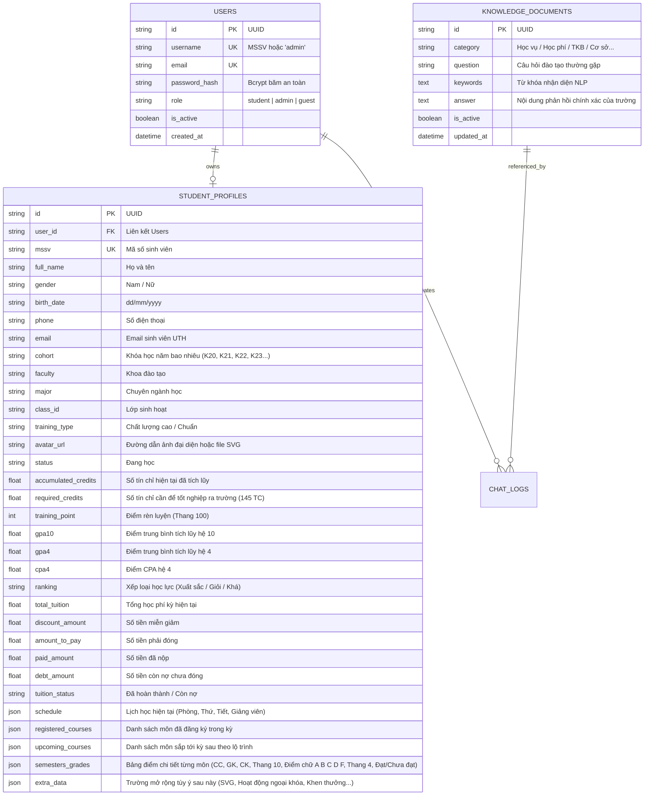

# 💾 THIẾT KẾ CƠ SỞ DỮ LIỆU (DATABASE SCHEMA)
**Dự án Cổng Sinh Viên & Trợ Lý Ảo UTH**

> **Hệ quản trị CSDL:** SQLite (Môi trường phát triển cục bộ) / PostgreSQL 16+ tích hợp Extension `pgvector` (Môi trường Production).  
> **ORM:** SQLAlchemy 2.0+ (FastAPI Python).  
> **Khả năng mở rộng:** Cấu trúc kết hợp bảng quan hệ và cột JSON động (`extra_data`, `schedule`, `semesters_grades`), cho phép chèn file ảnh SVG hoặc bổ sung trường dữ liệu mới bất kỳ lúc nào mà không cần migration phức tạp.

---

## 1. Sơ đồ thực thể dữ liệu chi tiết (ERD)

---

## 2. Quy tắc quy chiếu điểm số UTH (Hệ 10 ➔ Điểm Chữ ➔ Hệ 4)

Hệ thống áp dụng đúng Quy chế đào tạo tín chỉ của Trường Đại học Giao thông Vận tải TP.HCM:

| Thang điểm 10 | Điểm Chữ | Thang điểm 4 | Xếp loại học phần | Trạng thái |
|:---:|:---:|:---:|:---:|:---:|
| 9.0 – 10.0 | **A+** | 4.0 | Xuất sắc | Đạt |
| 8.5 – 8.9 | **A** | 4.0 | Giỏi | Đạt |
| 8.0 – 8.4 | **B+** | 3.5 | Khá giỏi | Đạt |
| 7.0 – 7.9 | **B** | 3.0 | Khá | Đạt |
| 6.5 – 6.9 | **C+** | 2.5 | Trung bình khá | Đạt |
| 5.5 – 6.4 | **C** | 2.0 | Trung bình | Đạt |
| 5.0 – 5.4 | **D+** | 1.5 | Trung bình yếu | Đạt |
| 4.0 – 4.9 | **D** | 1.0 | Yếu | Đạt |
| < 4.0 | **F** | 0.0 | Kém | **Chưa đạt (Học lại)** |

---

## 3. Danh sách 20 tài khoản sinh viên mẫu & 1 tài khoản Admin

> Tất cả 20 sinh viên đều có mật khẩu mặc định: **`123456`**.  
> Tài khoản Admin: **`admin`** | Mật khẩu: **`Admin@123`**.

| STT | MSSV | Họ và tên | Khóa | Khoa / Chuyên ngành | GPA (Hệ 4) | Điểm RL | Tín chỉ | Tình trạng Học phí |
|:---:|:---:|---|:---:|---|:---:|:---:|:---:|:---:|
| **0** | `admin` | **Ban Quản Trị Hệ Thống UTH** | - | *Quản trị viên Hệ thống* | - | - | - | **Admin Toàn quyền** |
| 1 | `056205008344` | Nguyễn Văn A | 2023 | CNTT · Công nghệ thông tin | 3.65 (Giỏi) | 90 | 52 / 145 | ✅ Đã hoàn thành (0 đ) |
| 2 | `056205008345` | Trần Thị Bích Ngọc | 2023 | CNTT · Kỹ thuật phần mềm | 3.82 (Xuất sắc) | 95 | 55 / 145 | ✅ Đã hoàn thành (0 đ) |
| 3 | `056204001234` | Lê Hoàng Minh | 2022 | Kinh tế vận tải · Logistics | 3.45 (Khá) | 82 | 82 / 145 | ⚠️ Còn nợ (4.500.000 đ) |
| 4 | `056204005678` | Phạm Quỳnh Anh | 2022 | Kinh tế vận tải · QTKD Vận tải | 3.70 (Giỏi) | 88 | 86 / 145 | ✅ Đã hoàn thành (0 đ) |
| 5 | `056203009988` | Đỗ Tuấn Kiệt | 2021 | Cơ khí · Kỹ thuật Ô tô | 3.10 (Khá) | 78 | 115 / 150 | ⚠️ Còn nợ (2.800.000 đ) |
| 6 | `056203007711` | Vũ Minh Đạt | 2021 | Điện - Điện tử · Tự động hóa | 3.55 (Giỏi) | 86 | 118 / 150 | ✅ Đã hoàn thành (0 đ) |
| 7 | `056205012301` | Bùi Thảo Linh | 2023 | Hàng hải · Khoa học Hàng hải | 3.60 (Giỏi) | 91 | 50 / 145 | ✅ Đã hoàn thành (0 đ) |
| 8 | `056202003322` | Hoàng Gia Bảo | 2020 | Xây dựng · Kỹ thuật Cầu đường | 3.25 (Khá) | 80 | 138 / 145 | ✅ Đã hoàn thành (0 đ) |
| 9 | `056205009912` | Ngô Diệu Hương | 2023 | Kinh tế vận tải · Cảng biển | 3.88 (Xuất sắc) | 96 | 54 / 145 | ✅ Đã hoàn thành (0 đ) |
| 10 | `056204008823` | Phan Đình Trọng | 2022 | CNTT · An toàn thông tin | 3.30 (Khá) | 75 | 80 / 145 | ⚠️ Còn nợ (6.200.000 đ) |
| 11 | `056203001155` | Trịnh Mỹ Duyên | 2021 | Kinh tế vận tải · Kinh tế biển | 3.92 (Xuất sắc) | 98 | 120 / 145 | ✅ Đã hoàn thành (0 đ) |
| 12 | `056205006677` | Dương Quốc Huy | 2023 | Cơ khí · Cơ điện tử | 2.95 (TB Khá) | 72 | 48 / 145 | ⚠️ Còn nợ (3.150.000 đ) |
| 13 | `056204004488` | Nguyễn Thùy Trang | 2022 | Kinh tế vận tải · Đa phương thức | 3.68 (Giỏi) | 89 | 85 / 145 | ✅ Đã hoàn thành (0 đ) |
| 14 | `056205002233` | Đặng Hữu Tài | 2023 | CNTT · AI & Data Science | 3.75 (Giỏi) | 93 | 53 / 145 | ✅ Đã hoàn thành (0 đ) |
| 15 | `056203008899` | Lý Thanh Vân | 2021 | Hàng hải · Kỹ thuật Tàu thủy | 3.52 (Giỏi) | 87 | 116 / 150 | ✅ Đã hoàn thành (0 đ) |
| 16 | `056202007744` | Huỳnh Tấn Phát | 2020 | Xây dựng · Công trình Thủy | 3.18 (Khá) | 81 | 140 / 145 | ⚠️ Còn nợ (1.500.000 đ) |
| 17 | `056205001122` | Tạ Khánh Ly | 2023 | Kinh tế vận tải · TMĐT Logistics | 3.80 (Xuất sắc) | 94 | 52 / 145 | ✅ Đã hoàn thành (0 đ) |
| 18 | `056204009944` | Mai Xuân Trường | 2022 | Điện - Điện tử · Viễn thông 5G | 3.40 (Khá) | 84 | 83 / 145 | ✅ Đã hoàn thành (0 đ) |
| 19 | `056205004455` | Cao Thị Mai | 2023 | Xây dựng · Kinh tế Xây dựng | 3.62 (Giỏi) | 90 | 51 / 145 | ✅ Đã hoàn thành (0 đ) |
| 20 | `056204003311` | Lương Gia Khiêm | 2022 | Xây dựng · Môi trường Đô thị | 3.28 (Khá) | 79 | 79 / 145 | ⚠️ Còn nợ (5.400.000 đ) |
